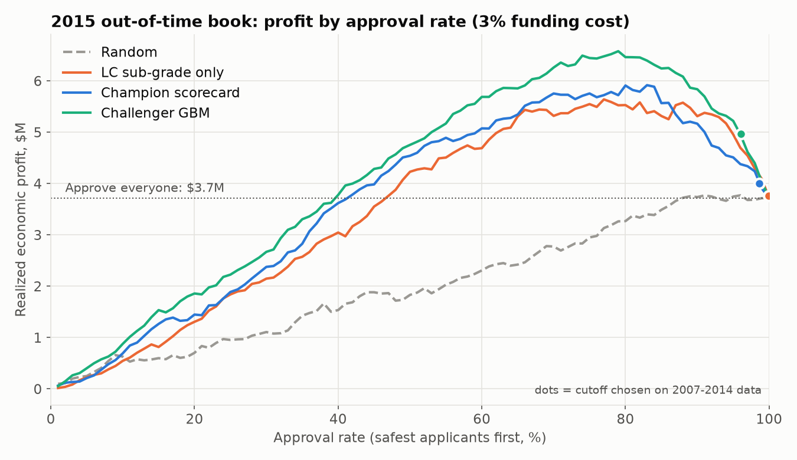
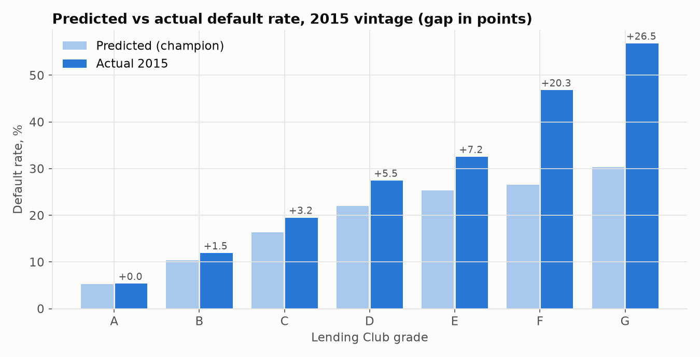
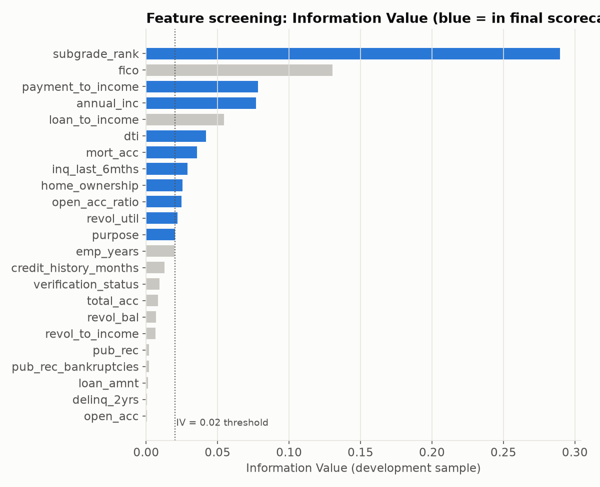

# Credit Line Strategy: PD Model to Profit-Optimal Cutoffs

Which loan applicants should a lender approve, and how much profit does a better risk model add?

This project builds a probability-of-default (PD) model on Lending Club loans, then turns it into an approval
strategy and measures it in dollars on a held-out year. It covers the steps a credit strategy team works through:
SQL data preparation, an interpretable scorecard, a machine learning challenger, profit simulation, champion/challenger
comparison and performance monitoring.



## Key results

Out-of-time test: **41,817 loans issued in 2015**. Models were built only on 2007-2014 loans (50,175).

| Ranking model | AUC (2015) | Gini | KS | Max profit, 2015 book* | Approval rate at max |
|---|---|---|---|---|---|
| Approve everyone | | | | $3.72M | 100% |
| Lending Club sub-grade only | 0.685 | 0.370 | 0.270 | $5.66M | 77% |
| **Champion: WoE logistic scorecard** | 0.685 | 0.370 | 0.276 | $5.99M | 83% |
| **Challenger: LightGBM** | 0.691 | 0.381 | 0.280 | $6.63M | 79% |

\*Realized economic profit at a 3% annual funding cost. "Max profit" is chosen in hindsight on 2015 outcomes and
is shown to compare how well each model ranks risk; see finding 3 for what a forward-looking cutoff achieved.

**1. A risk-ranked cutoff earns up to 1.8x more than approving everyone.** Declining the riskiest ~20% of applicants
lifts profit on the 2015 book from $3.7M to $6.6M. That group defaults at 29% and loses $2.7M, even though it pays an
average 15.8% interest rate versus 10.1% for approved loans.

**2. Application data adds value beyond the external grade.** Lending Club's own grade is treated like a bureau score.
At every approval rate the ordering is challenger > champion > grade alone > random. At 80% approval: $6.46M vs $5.91M vs $5.53M.

**3. Cutoffs set on history were too lenient for 2015.** A cutoff tuned on 2007-2014 data would have approved 96-99% of
2015 applicants and captured only part of the gain ($4.97M with the challenger, $4.00M with the champion). 2015 was riskier than
any development year: Lending Club cut rates while defaults rose.

**4. The model ranks well but its PD level drifted.** Predicted vs actual 2015 default rate is on target for grade A but
understated by 1.5 points for B, 3.2 for C and 5.5 for D. The score distribution itself was stable (PSI < 0.01),
so this is calibration drift rather than a population shift.



**5. Champion vs challenger swap set.** At 80% approval the two models disagree on 1,717 loans each way. The challenger's
swap-ins default at 21.2% vs 24.2% for the champion's swap-outs, a net gain of about $0.55M.

### Recommendation

- Adopt risk-ranked approval with a cutoff around 80% at a 3% funding cost. The optimal approval rate is sensitive to the
  funding assumption: at 4%, approving everyone loses $4.3M and the best cutoffs fall to roughly 50-65% approval
  (`reports/strategy_results.csv`).
- Recalibrate PD on the most recent vintages before setting cutoffs, and tighten grades C-E where 2015 pricing no longer covered
  expected loss plus funding cost.
- Run the GBM challenger as a controlled champion/challenger test on a share of applications before full rollout. It earns more
  but is harder to explain to applicants and model validation than the scorecard.
- Monitor predicted vs actual default by vintage and score PSI monthly.

## Method

**Population (SQL, `sql/features.sql`).** 36-month individual loans issued 2007-2015 with a final outcome. All of these loans
reached maturity before the data snapshot. Later vintages only contain loans that already ended, which overstates their default
rate, so they are excluded. Default = "Charged Off".

**Features.** Application-time data only: FICO, income, DTI, inquiries, utilization, mortgage accounts, home ownership, loan purpose,
engineered ratios (payment-to-income, loan-to-income, open-to-total accounts) and Lending Club's sub-grade. Post-origination
fields (payments, recoveries) are used only to compute profit, never as features, to avoid target leakage.

**Champion: Weight-of-Evidence scorecard (`src/woe_scorecard.py`).**
- Quantile binning with bins merged until the bad rate is monotonic; missing values get their own bin
- Information Value screen (IV >= 0.02), correlation filter (|r| > 0.6, keep higher IV), wrong-sign coefficients removed
- Logistic regression on WoE values, scaled to points (600 at 50:1 odds, 20 points to double the odds)
- Final model: 10 features. FICO was dropped because it is highly correlated with the sub-grade, which already contains it.
  Full points table in `reports/scorecard_points.csv`

**Challenger: LightGBM (`src/challenger.py`).** Same features and population, early stopping on a validation split of the
development data. The 2015 sample is never used for training or tuning.

**Profit simulation (`src/profit_sim.py`).** For each loan:

```
economic profit = payments received x (1 - 1% servicing fee)
                - collection fees - principal
                - funding rate x principal x 1.5 years average life
```

Applicants are approved safest-first by predicted PD. Results are reported for funding costs of 2%, 3% and 4%.



## Limitations

- **Approved loans only.** Lending Club data contains no rejected applicants, so the models never see the riskiest part of the
  applicant population (no reject inference).
- **Simplified economics.** Funding cost and average life are assumptions, and cash flows are not discounted.
- **Thin tails.** Grades F and G have few 2015 loans (203 and 44), so their calibration gaps are noisy.
- **Sample.** The models use a 200,000-loan random sample of completed loans, not the full 1.3M.

## Repository structure

```
├── prepare_sample.py         # sample the raw Kaggle file -> data/lc_sample.csv
├── run_pipeline.py           # runs everything end to end
├── sql/
│   ├── features.sql          # population + feature engineering
│   └── portfolio_summary.sql # default rate, LGD and return by grade x vintage
├── src/
│   ├── load_data.py          # CSV -> SQLite, runs the SQL, out-of-time split
│   ├── woe_scorecard.py      # binning, WoE/IV, scorecard, points table
│   ├── challenger.py         # LightGBM challenger
│   ├── evaluate.py           # AUC, Gini, KS, PSI, decile tables
│   ├── profit_sim.py         # economics, cutoffs, swap set, expected vs actual
│   └── plots.py
├── notebooks/analysis.ipynb  # walkthrough with results
└── reports/                  # output tables (CSV) and figures
```

## Reproduce

1. Download `accepted_2007_to_2018Q4.csv.gz` from the Kaggle dataset
   [Lending Club Loan Data (wordsforthewise)](https://www.kaggle.com/datasets/wordsforthewise/lending-club) into `data/`.
2. Install and run:

```bash
python -m venv .venv
source .venv/bin/activate            # Windows: .venv\Scripts\activate
pip install -r requirements.txt
python prepare_sample.py data/accepted_2007_to_2018Q4.csv.gz
mv lc_sample.csv data/               # Windows: move lc_sample.csv data\
python run_pipeline.py
```

The pipeline runs in under a minute. The data is not included in this repository.

**Tools:** Python (pandas, scikit-learn, LightGBM, matplotlib), SQL (SQLite), Jupyter.
